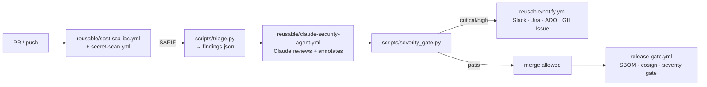

# claude-security-agent

An enterprise **Claude security agent** for GitHub, packaged as **reusable org-level
workflows**. Drop a few lines into any repo in your org and every pull request and push is
automatically reviewed for OWASP Top-10 issues, scanned with GitHub Advanced Security
(CodeQL, Dependabot, secret push protection), gated by severity, and — for critical/high
findings — escalated to Slack, Jira, and Azure DevOps.

> **New here / just got access?** Start with [`docs/getting-started.md`](docs/getting-started.md),
> then browse the full [documentation index](docs/README.md).

## What it does

- **Shift-left security review** on every PR/push: SAST (CodeQL + Semgrep), SCA
  (dependency review + Trivy), IaC (Checkov/tfsec), and secret scanning (TruffleHog/gitleaks).
- **Claude-driven triage:** the [`claude-code-action`](https://github.com/anthropics/claude-code-action)
  reads the diff + normalized findings and posts **line-level** remediation comments, opens
  remediation PRs for trivial fixes, and emits a normalized `findings.json`.
- **Severity-based gating:** critical/high block the merge and require 2 approvers; medium
  requires 1; low is digest-only. See [`policies/severity-matrix.md`](policies/severity-matrix.md).
- **OIDC least-privilege deploys** for AWS, Azure, and GCP — no long-lived cloud secrets.
- **Alerting:** Slack notifications + auto-created Jira issues and Azure DevOps work items,
  plus GitHub Issues, for high/critical findings.
- **Severity-gated releases** with SBOM + keyless signing.

## Architecture



See [`docs/architecture.md`](docs/architecture.md) for the full shift-left diagram.

## Adopt it in a downstream repo (3 lines)

Copy [`examples/consumer-workflow.yml`](examples/consumer-workflow.yml) into the consumer
repo's `.github/workflows/`. Minimal form:

```yaml
jobs:
  security:
    uses: <org>/claude-security-agent/.github/workflows/reusable-claude-security-agent.yml@main
    with:
      production: true
    secrets: inherit
```

Full onboarding (required secrets, branch protection, OIDC trust): [`docs/onboarding.md`](docs/onboarding.md).

## Required secrets

| Secret | Used by |
| ------ | ------- |
| `ANTHROPIC_API_KEY` | Claude agent |
| `SLACK_WEBHOOK_URL` | Slack notifications |
| `JIRA_BASE_URL`, `JIRA_USER`, `JIRA_TOKEN`, `JIRA_PROJECT` | Jira tickets |
| `ADO_ORG_URL`, `ADO_PROJECT`, `ADO_PAT` | Azure DevOps work items |
| OIDC trust (no static keys) | AWS role ARN / Azure client+tenant / GCP WIF provider |

See [`docs/oidc-setup.md`](docs/oidc-setup.md) for per-cloud OIDC trust configuration.

## Layout

| Path | Purpose |
| ---- | ------- |
| `.github/claude-security/claude-security-prompt.md` | The agent's behavior (single source of truth) |
| `.github/workflows/reusable-*.yml` | Reusable (`workflow_call`) building blocks |
| `.github/workflows/*.yml` | This repo's own callers (also serve as examples) |
| `scripts/` | Triage, severity gate, and notifier scripts |
| `policies/` | Severity matrix, branch-protection ruleset, OPA policies |
| `docs/` | Architecture, onboarding, OIDC setup, output schema |
| `examples/` | Copy-paste consumer workflow |

## License

[MIT](LICENSE).
