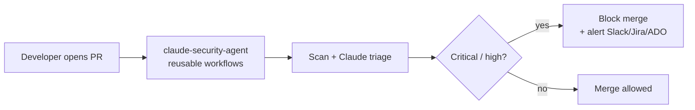

# Documentation index

Welcome to **claude-security-agent**. This folder explains what the repo is, why it exists,
how it works, and what to do when you're given access. Read in this order:

| # | Doc | Read it when you want to… |
| - | --- | -------------------------- |
| 1 | [getting-started.md](getting-started.md) | **You just got access** — your first 30 minutes, by role |
| 2 | [when-to-use.md](when-to-use.md) | Understand **why** this exists and **when** to use (or not use) it |
| 3 | [architecture.md](architecture.md) | See **how** the pieces fit — flow + sequence diagrams |
| 4 | [repo-guide.md](repo-guide.md) | Know **what every file does** and when you'd edit it |
| 5 | [onboarding.md](onboarding.md) | **Adopt the agent in another repo** (the consumer side) |
| 6 | [oidc-setup.md](oidc-setup.md) | Wire up **cloud deploy** auth (AWS / Azure / GCP, OIDC only) |
| 7 | [outputs-schema.md](outputs-schema.md) | Understand the **findings JSON** contract |

## The 60-second version

This repo is a **security reviewer built from reusable GitHub Actions**. Other repos in the
org "subscribe" to it with a few lines of YAML. From then on, every pull request and push is
scanned (SAST/SCA/IaC/secrets), the findings are handed to **Claude** for human-readable
triage and inline fix suggestions, a **severity gate** blocks merges that carry critical/high
issues, and alerts fan out to **Slack, Jira, Azure DevOps, and GitHub Issues**. Cloud deploys
use **short-lived OIDC** — never stored credentials.

## Who maintains it

The **security team** (see [`.github/CODEOWNERS`](../.github/CODEOWNERS)) owns the agent
behavior, workflows, gating logic, and policies. Changes to those paths require their review.
