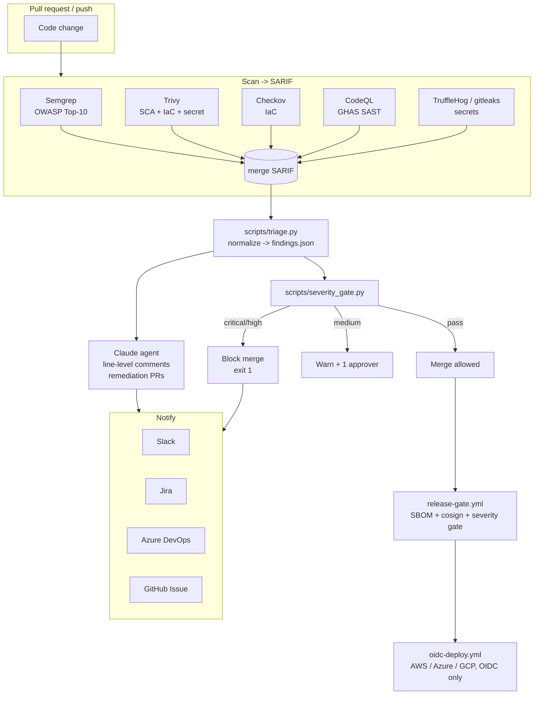

# Architecture

The agent is a set of composable **reusable workflows**. A downstream repo's caller invokes
`reusable/claude-security-agent.yml`, which fans out the shift-left gates below.

## Shift-left gates

## Components

| Stage | Workflow / script | Output |
| ----- | ----------------- | ------ |
| Scan | `reusable/sast-sca-iac.yml`, `reusable/secret-scan.yml`, `codeql.yml` | SARIF |
| Normalize | `scripts/triage.py` | `findings.json` |
| Review | `reusable/claude-security-agent.yml` → `anthropics/claude-code-action` | PR comments, remediation PRs |
| Gate | `scripts/severity_gate.py` | exit code + step summary |
| Notify | `reusable/notify.yml` + `scripts/notify_*.py` / `create_*` | Slack, Jira, ADO, GitHub Issue |
| Release | `release-gate.yml` | SBOM, cosign signature, GitHub Release |
| Deploy | `reusable/oidc-deploy.yml` | short-lived OIDC cloud auth |

## Design principles

- **Behavior lives in the prompt**, not the YAML — edit
  `.github/claude-security/claude-security-prompt.md` to change what the agent does.
- **Reusable + thin callers** — consumer repos add a few lines and inherit secrets.
- **Fail safe** — scanners run with `continue-on-error` so a scanner outage never silently
  passes a PR; the severity gate is the single authoritative block.
- **No long-lived cloud secrets** — OIDC only, enforced by `policies/opa`.
