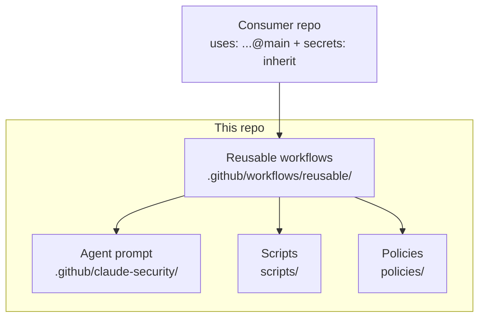

# Getting started — you just got access

This page is for someone who was **just granted access** to (or asked to collaborate on)
`claude-security-agent`. It tells you what this repo is, what's safe to do, and your first
steps by role. Budget ~30 minutes.

## What this repo is (and isn't)

- **It is** the org's automated security reviewer, shipped as **reusable GitHub Actions
  workflows** plus the Claude agent's instructions. Other repos call it; it reviews their PRs.
- **It is not** an application. There's no server to run. The "product" is the workflows in
  `.github/workflows/reusable/`, the agent prompt, and the helper scripts.
- **Behavior lives in one file:** `.github/claude-security/claude-security-prompt.md`. If you
  want to change *what the agent flags or how it comments*, that's the file — not the YAML.

## Mental model



A consumer repo adds a few lines of YAML (see [onboarding.md](onboarding.md)); everything
else is provided here.

## First 30 minutes

1. **Read the [docs index](README.md)** and [when-to-use.md](when-to-use.md) to get the why.
2. **Skim the agent prompt** — `.github/claude-security/claude-security-prompt.md`. This is
   the heart of the system; everything else exists to feed it findings and act on its output.
3. **Trace one path** with [architecture.md](architecture.md): PR → scan → triage → gate →
   notify. The [repo-guide.md](repo-guide.md) maps each file to that path.
4. **Run the scripts locally** (no secrets needed):
   ```bash
   python -m py_compile scripts/*.py            # everything compiles
   # normalize a SARIF file and run the gate:
   python scripts/triage.py --repo demo/x --sarif some.sarif --out findings.json
   python scripts/severity_gate.py --findings findings.json --production true
   ```
   The notifier scripts **self-skip** when their env vars aren't set, so they're safe to run.

## What to do, by role

### New collaborator / contributor
- Make changes on a **branch** and open a **PR** — never push to `main` (it's protected).
- Keep `scripts/severity_gate.py` in sync with [`policies/severity-matrix.md`](../policies/severity-matrix.md)
  if you touch thresholds.
- Before pushing: `actionlint .github/workflows/**/*.yml` and `python -m py_compile scripts/*.py`.
- Fill in the PR template checklist (`.github/pull_request_template.md`).

### Security team / maintainer (CODEOWNER)
- You own `/.github/claude-security/`, `/.github/workflows/`, `/scripts/`, `/policies/`.
- Tune the agent prompt and severity matrix as the org's risk appetite changes.
- Manage org-level secrets (`ANTHROPIC_API_KEY`, `SLACK_*`, `JIRA_*`, `ADO_*`) and OIDC trust.

### Platform / DevOps engineer rolling it out to repos
- Follow [onboarding.md](onboarding.md) to add the consumer workflow + secrets to each repo.
- Apply branch protection from [`policies/branch-protection.json`](../policies/branch-protection.json).
- Configure cloud OIDC trust per [oidc-setup.md](oidc-setup.md) before enabling deploy gating.

## Ground rules

- **Never commit secrets.** All integrations read from GitHub Actions secrets; cloud auth is
  OIDC-only. The repo's own `secret-scan` job runs against every push as a backstop.
- **Least privilege.** Any new workflow job sets the minimum `permissions:` it needs.
- **Don't weaken gates.** The severity gate is the single authoritative merge block — don't
  add `continue-on-error` to it or lower thresholds without security-team sign-off.

## Where to get help

- Architecture questions → [architecture.md](architecture.md)
- "What is this file?" → [repo-guide.md](repo-guide.md)
- Adoption / secrets → [onboarding.md](onboarding.md)
- Reporting a vulnerability in this repo → [`SECURITY.md`](../SECURITY.md)
