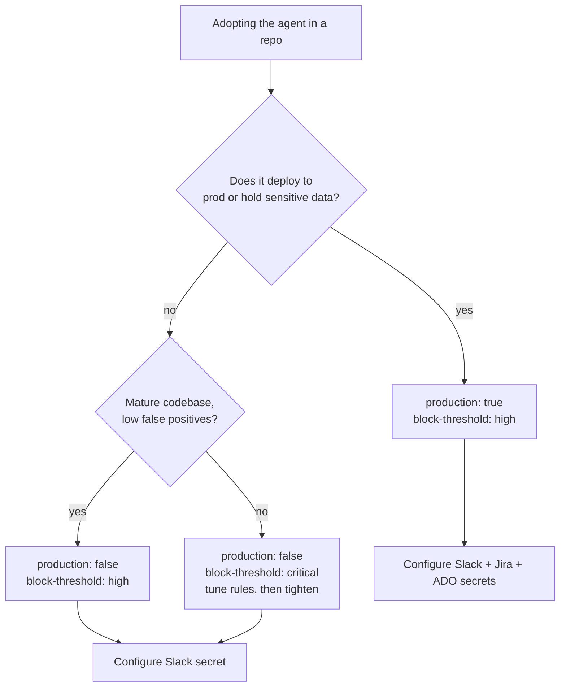

# Why this exists & when to use it

## Why

Security review that only happens at release time is too late and too slow. This repo exists
to **shift security left** — to the moment a pull request opens — and to make the result
*actionable* rather than a wall of scanner noise. Three problems it solves:

1. **Scanners produce noise, not decisions.** CodeQL, Semgrep, Trivy, and friends each emit
   their own SARIF. We normalize them into one list, map to CVSS-based severity + CWE, and let
   **Claude** explain each finding in plain language with a concrete fix — at the exact line.
2. **Gates are inconsistent across repos.** Every team reinvents "block on critical." Here the
   gate is defined **once** ([`severity-matrix.md`](../policies/severity-matrix.md)) and reused,
   so "critical/high blocks the merge" means the same thing everywhere.
3. **Findings get lost.** Critical/high issues auto-escalate to Slack, Jira, Azure DevOps, and
   GitHub Issues with an owner and remediation steps — no silent backlog.

## When to use it

✅ **Use it for:**
- Any repo that ships code or infrastructure to an environment you care about.
- **Production** repos especially — set `production: true` for stricter gates (2 approvers,
  auto Jira + ADO tickets).
- Repos with cloud deploys — the OIDC deploy gate enforces short-lived credentials.
- Standardizing security across **many** repos from one place.

⚠️ **Use with adjustments:**
- **Monorepos / huge codebases** — scope the scanners (paths, languages) so runs stay fast.
- **Repos with heavy false positives** — keep `block-threshold: high` and tune scanner rules
  before tightening to `medium`; let humans triage medium/low.

❌ **Probably skip it for:**
- Throwaway scratch/spike repos with no deploy target.
- Mirrors of third-party code you don't change.
- Repos where another mandated security pipeline already provides equivalent gating (avoid
  double-gating that just slows merges).

## Choosing your settings

## What "good" looks like once adopted

- A PR with a real vulnerability gets **blocked** with an inline explanation and a suggested
  fix, plus a ticket assigned to an owner.
- A clean PR passes all required checks and is mergeable with the required approvals.
- Releases can't ship with an unresolved critical/high CVE.
- No long-lived cloud keys exist anywhere — only OIDC.

## Trade-offs to be honest about

- **Latency:** scans add a few minutes to PR feedback. Worth it for the catch rate; scope
  scanners on large repos to keep it tight.
- **False positives:** SAST/SCA will occasionally over-report. That's why medium/low are
  *warn/log*, not *block*, and a human stays in the loop.
- **Cost:** the Claude review consumes API tokens per PR. The agent still adds value without
  a key (scans + gate run), but you lose the natural-language triage and auto-fix PRs.
